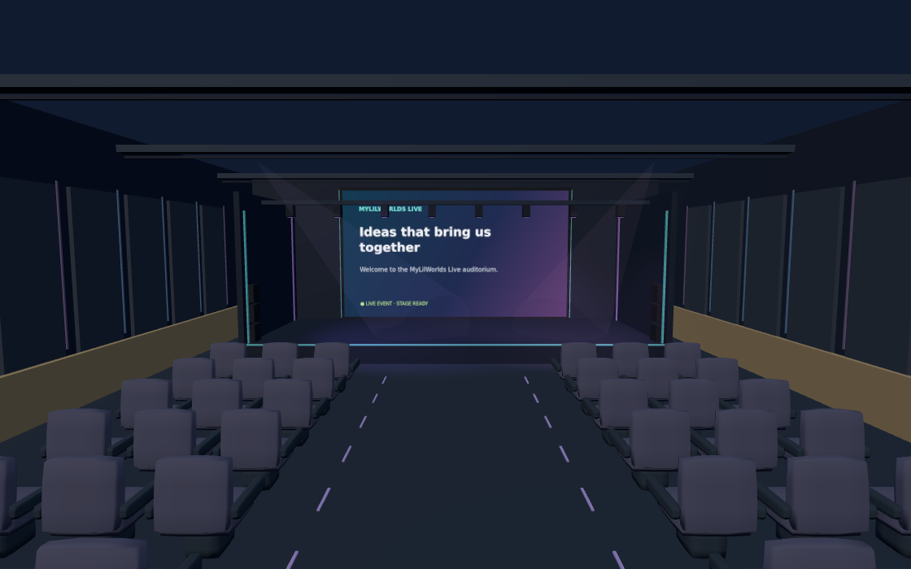
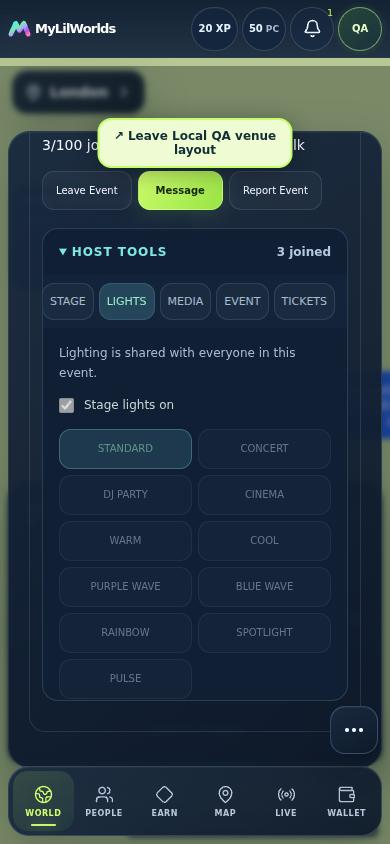
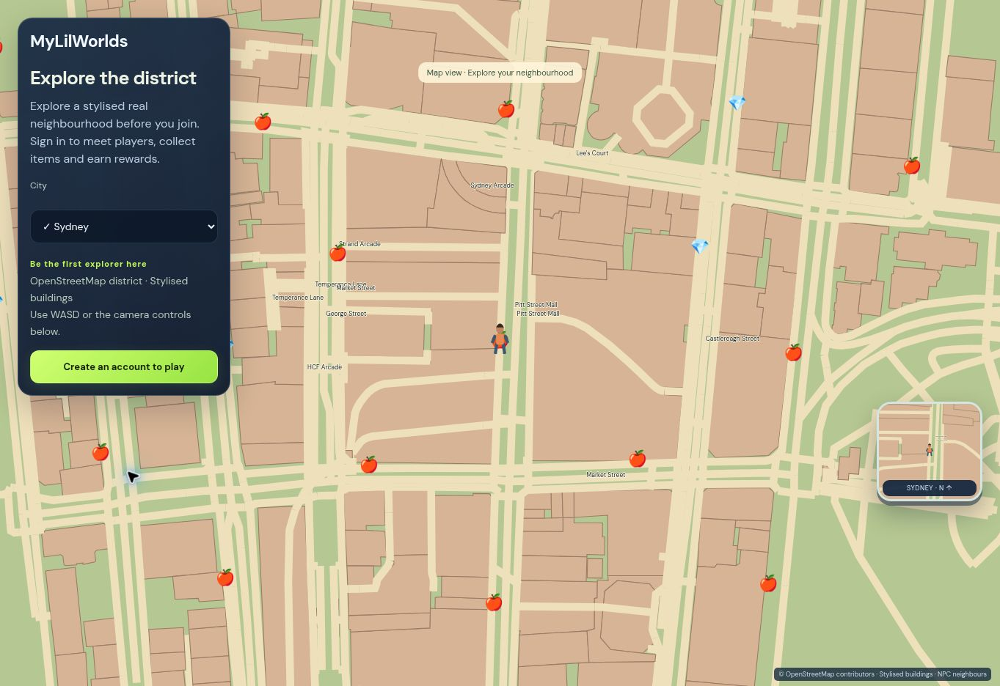

# MyLilWorlds — Event presentation release validation

Date: 30 September 2026. Application commit: `426edc7b536d0f66227f412b42443bf945b194a2`.

**Deployed to the existing Railway service; public verification passed. Full production acceptance remains incomplete.**

The existing application, repository, Railway service, database, authentication, WebSocket and LiveKit architecture were continued in place. No production test users, artificial funds or activity were created.

## Evidence and acceptance meaning

- Functional CI: [run 36710128208](https://github.com/sainsabu41-cmyk/pulseworld/actions/runs/36710128208), 336 checks across seven independent city jobs, 229 backend tests, 31 frontend tests, PostGIS migration checks, security audits and production builds: PASS.
- Exact final commit CI: [run 36711938964](https://github.com/sainsabu41-cmyk/pulseworld/actions/runs/36711938964), all ten jobs SUCCESS. All seven city logs independently report 48 completed multiuser checks each (336 total).
- Railway's actual release image independently passed all 229 backend tests in 417.72 seconds. Deployment reached SUCCESS at 12:09:18 UTC; startup, readiness and the `/api/health` deployment check passed.
- Live public landing and Whitehouse/Sydney previews loaded; the existing 45-destination catalogue and new shared UI marker were present, with no horizontal overflow. A Sydney keyboard input moved the map by the preserved 1.5-metre step. Railway proxy logs record `/api/health` HTTP 200 at 12:13:03 UTC.
- Final local production build and responsive Event controls at 390/820/1100 pixels: PASS. Six Host Tools tabs and a first-click lighting change were exercised.
- Shared auditorium software-WebGL fixture: 110 draw calls, one title texture and two lights across four presets, with no page errors. Rounded instanced seating reduced the fixture from 240 draws. This is not a physical-device FPS measurement.
- Real browser CI uses synthetic camera/microphone/desktop sources over real LiveKit/WebRTC. The seven-city matrix uses the existing map fallback; the venue asset render is a separate software-WebGL check.

**Matrix interpretation:** Build/QA PASS describes the specific tested implementation below. Production acceptance FAIL means a required live/provider/physical-device check is unverified or blocked, not that the corresponding CI test failed. This preserves the requested PASS/FAIL format without claiming production behavior from compilation or synthetic media alone.

Production acceptance of authenticated flows needs authorised existing test accounts. A real Stripe purchase also needs the missing payment/webhook configuration. Physical Safari/iOS/Android and normal-GPU performance remain open.

## PREVIOUS PENDING DEPLOYMENT

Previous exact release bd7e33de; independent 222-test image and live public verification.

| Check | Build / QA | Production acceptance |
|---|---|---|
| Previous Build Completed | PASS | PASS |
| Independent Backend Test | PASS | PASS |
| Railway Deployment | PASS | PASS |
| Live Health Check | PASS | PASS |
| Previous Changes Verified | PASS | PASS |

## SCREEN SHARING

Host + three receivers, real WebRTC with synthetic capture; source ownership, permission and cleanup checks.

| Check | Build / QA | Production acceptance |
|---|---|---|
| Host Screen Share | PASS | FAIL |
| Participant Request To Share | PASS | FAIL |
| Host Allow | PASS | FAIL |
| Host Revoke | PASS | FAIL |
| One Primary Share | PASS | FAIL |
| Presenter Switching | PASS | FAIL |
| Stage Wall Share Rendering | PASS | FAIL |
| Presenter Camera Card | PASS | FAIL |
| Mic During Screen Share | PASS | FAIL |
| Screen Audio Where Supported | PASS | FAIL |
| Disconnect Cleanup | PASS | FAIL |

## LOCAL VIEW MODES

Separate browser contexts; layout independence, unchanged positions and room continuity checked.

| Check | Build / QA | Production acceptance |
|---|---|---|
| Participant Minimise Local Only | PASS | FAIL |
| Participant Expand Local Only | PASS | FAIL |
| Participant Fullscreen Local Only | PASS | FAIL |
| Host Fullscreen Local Only | PASS | FAIL |
| No View-State Broadcast | PASS | FAIL |
| Back To Event | PASS | FAIL |
| No Event Reconnect | PASS | FAIL |
| No Avatar Position Change | PASS | FAIL |

## VIDEO WALL STATES

Decoded share/camera source selection and default artwork checks; shared venue asset render separately verified.

| Check | Build / QA | Production acceptance |
|---|---|---|
| Screen Share Priority | PASS | FAIL |
| Current Speaker Video Preserved | PASS | FAIL |
| Default MyLilWorlds Wall | PASS | FAIL |
| Event Title | PASS | FAIL |
| Event Description | PASS | FAIL |
| No Black/Frozen Wall | PASS | FAIL |

## EVENT / AUDITORIUM

Venue render, event media regression, shared lighting and existing server role checks; responsive Host Tools fixture.

| Check | Build / QA | Production acceptance |
|---|---|---|
| Premium Venue | PASS | FAIL |
| Large Stage | PASS | FAIL |
| Video Wall | PASS | FAIL |
| Stage Lighting | PASS | FAIL |
| Lighting Sync | PASS | FAIL |
| Participant List | PASS | FAIL |
| Raise Hand | PASS | FAIL |
| Bring To Stage | PASS | FAIL |
| Speaker Audio | PASS | FAIL |
| Speaker Video | PASS | FAIL |

## MOVEMENT

Shared Preview calibration, server movement/geography tests and mutual realtime walk/run/call checks.

| Check | Build / QA | Production acceptance |
|---|---|---|
| Preview City Preserved | PASS | PASS |
| Authenticated Walk Matches Preview | PASS | FAIL |
| Authenticated Run Matches Preview | PASS | FAIL |
| Natural Walk | PASS | FAIL |
| Natural Run | PASS | FAIL |
| Remote Sync | PASS | FAIL |
| Movement During Voice | PASS | FAIL |
| Movement During LiveFace | PASS | FAIL |

## SOCIAL CONNECTION

Authoritative consent/group helper, disabled Connected CTA, API idempotency and multiuser acceptance.

| Check | Build / QA | Production acceptance |
|---|---|---|
| Can We Talk | PASS | FAIL |
| Accept | PASS | FAIL |
| Connected State | PASS | FAIL |
| CTA Hidden After Accept | PASS | FAIL |
| No Duplicate Request | PASS | FAIL |

## CREDITS / COMMERCE

Existing ledger/payment/gift regressions and new reservation tests; no real production Stripe charge.

| Check | Build / QA | Production acceptance |
|---|---|---|
| Stripe Purchase | FAIL | FAIL |
| Webhook Verification | PASS | FAIL |
| Credit Ledger | PASS | FAIL |
| Venue Rental | PASS | FAIL |
| Gift Purchase | PASS | FAIL |
| No Duplicate Charges | PASS | FAIL |
| No Negative Balance | PASS | FAIL |

## GLOBAL COLLECTIBLES

Bounded rotations, lazy materialisation, cross-city coverage, duplicate/rate/proximity rejection and preserved authored items.

| Check | Build / QA | Production acceptance |
|---|---|---|
| Gems | PASS | FAIL |
| Fruits | PASS | FAIL |
| Crystals | PASS | FAIL |
| Treasure | PASS | FAIL |
| Respawn | PASS | FAIL |
| Anti-Exploit | PASS | FAIL |
| UK Worlds | PASS | FAIL |
| International Worlds | PASS | FAIL |

## RESPONSIVE

Chromium desktop, 390px touch/mobile and 820px tablet emulation; additional 1100px event-control fixture.

| Check | Build / QA | Production acceptance |
|---|---|---|
| Desktop | PASS | FAIL |
| Mobile | PASS | FAIL |
| Tablet | PASS | FAIL |
| No Text Overlap | PASS | FAIL |
| First Tap | PASS | FAIL |

## FINAL PRODUCTION

Recorded after exact-commit deployment, additive migrations and live public checks. Post-Deployment Verification remains FAIL for the complete authenticated acceptance journey; the public smoke checks passed. Existing Data Preserved remains FAIL as a full production-data audit has not been performed; the migration changes are additive and no reset was issued.

| Check | Build / QA | Production acceptance |
|---|---|---|
| Production Build | PASS | PASS |
| Safe Migration | PASS | PASS |
| Railway Deployment | PASS | PASS |
| Production Health | PASS | PASS |
| Post-Deployment Verification | PASS | FAIL |
| Existing Data Preserved | PASS | FAIL |

## Deployment evidence

Existing Railway service: `f28de9c9-b5c5-43da-bdfe-73aa4826d0b0` (`pulseworld`). New deployment: `631b9960-7ccc-45e1-852c-0fb3fe41f8ce`. Exact commit: `426edc7b536d0f66227f412b42443bf945b194a2`. Status: **SUCCESS**, 30 September 2026 at 12:09:18 UTC. Verified public preview: https://pulseworld-production.up.railway.app/explore. No service or environment was created.

The existing launcher runs `alembic upgrade head` with `check=True` before starting the API. Successful API startup/readiness therefore confirms completion of that migration gate; no direct production table or balance audit is claimed. The cloud browser blocked direct navigation to the API health page, so health evidence comes from Railway's successful deployment check and HTTP 200 proxy log, not a browser JSON-body inspection.

## Implementation / root-cause report

### 1. What remained pending from the previous deployment.

The earlier bd7e33de release was awaiting independent build/deployment verification. Before this extension, its existing Railway deployment cff86ad4-f33e-4eef-a683-cece7611ea17 was freshly confirmed SUCCESS, with 222 backend tests in that image and live health/landing/preview checks. No second service or project was created.

### 2. Result of the independent backend test.

The new backend suite contains 229 tests. The independent CI run passed against its configured PostGIS/Redis environment, including migration upgrade/check and dependency audit. Railway also passed all 229 inside its actual unified release image in 417.72 seconds. One existing Starlette/httpx deprecation warning was non-failing.

### 3. Railway deployment result.

Deployment 631b9960-7ccc-45e1-852c-0fb3fe41f8ce reached SUCCESS for exact application commit 426edc7b536d0f66227f412b42443bf945b194a2. It uses the original project, environment and pulseworld service.

### 4. Live health-check result.

Railway's `/api/health` deployment check passed at 12:09:14 UTC, API readiness returned 200, and proxy logs recorded `/api/health` 200 at 12:13:03 UTC. Public landing, UK/international preview, 45-place catalogue and keyboard movement checks passed. Authenticated production media acceptance is listed separately from these public checks.

### 5. Root cause of authenticated movement being slower than Preview City.

Preview advanced 1.5 virtual metres per 120 ms input interval. Authenticated movement used independent 3.2/6 walk/run limits. Preview has one pace, with no independent run selector; the existing gait interprets its 12.5 m/s pace as running. Its apparent pace therefore differed from the server-authoritative main world.

### 6. How movement parity was implemented.

shared/movement.json retains Preview’s exact 1.5/120 ms values. Authenticated run derives 12.5 m/s from them; walk is 6.6667 using the existing 1.875 ratio. Acceleration is 240 ms, diagonal intent stays normalised, idle input cannot bank a large movement step, and collision remains server authoritative. Preview’s path, collision and gait were preserved. There is no separate Preview walk value to copy.

### 7. Why Can We Talk remained after connection.

The nearby and person-card request actions did not derive their label/disabled state from accepted session membership. Local feedback could disappear while the underlying connection remained accepted.

### 8. How connection state was corrected.

A shared peerConnection helper derives Pending/Connected from authoritative sessions and group membership, excluding unrelated Event membership. Immediate acknowledgement bridges the next snapshot. Connected replaces the request CTA; request locks and existing-group lookup prevent duplicate invitations. Media layout never owns this state.

### 9. How screen-share tracks are published.

An explicit Share screen click invokes LiveKit createScreenTracks with the browser picker before awaiting network work. The server reserves the presenter, grants source permissions, then verifies the published screen SID through the existing LiveKit room API before selecting it. Screen capture is bounded to 1280×720, 15 fps and 1.8 Mbps. Optional audio is published only when the browser/source supplies it.

### 10. How camera vs screen-share tracks are distinguished.

Track publication source and SID are authoritative: camera and microphone remain in their existing avatar/audio slots; screen_share and screen_share_audio use separate source-owned elements. A screen is accepted only for the authenticated selected owner and provider-confirmed SID. Video elements are muted and local audio is never played back to its publisher.

### 11. How the large wall selects its current source.

MediaTiles selects the authorised screen element and emits the existing local stage-media event. World binds that element to a Three.js VideoTexture on the existing large wall. The playback-only presentation viewer mirrors the selected stream without creating another room or publishing tracks.

### 12. How the wall fallback priority works.

Priority is authorised live screen, then the existing eligible speaker camera, then a reusable MyLilWorlds Live canvas containing event title, description and status. Unsubscribe/mute/removal clears stale selections; stopping a screen keeps the microphone attached and restores the camera or artwork.

### 13. How Host grants/revokes screen-share permission.

Host/cohost authorization uses the existing Event role check. Share permission is a separate Attendee state, independent of speaking or raised hand. Request, allow, decline, revoke and switch are audited. Revocation updates source-level LiveKit permissions and the authenticated Event snapshot; the client stops its owned capture on either signal. A revision guard prevents stale snapshots stopping a newer share.

### 14. How presenter switching works.

Switch reserves the next approved presenter while the existing presentation stays selected. Only a provider-confirmed new screen takes over the primary wall. The former publisher loses screen permission while retaining any existing microphone/camera entitlement. Exactly one primary SID is selected.

### 15. How disconnect cleanup works.

Browser stop, component cleanup, explicit Stop sharing and permission/ownership changes stop only the capture-owned tracks. A UUID scopes stop requests so an old tab cannot stop a newer presentation. Participant departure clears playback immediately; a 10-second heartbeat and 40-second server lease cover abandoned presentation state. CI separately verifies a closed presenter browser; the backend tests lease expiry.

### 16. How local fullscreen is prevented from becoming shared Event state.

Minimise/normal/expanded/fullscreen are local React state in PresentationView. No view-mode field is written to the Event, no view-mode API exists and no view-mode message is sent. Tests inspect other participants’ layouts and shared Event state after changing one viewer.

### 17. How mobile fullscreen/expand works.

The viewer uses a bounded responsive panel or a local viewport-filling layout, with Back to Event and Exit full screen. Its muted mirror does not own audio or room lifecycle. The minimised viewer is restored through View stage in the existing media controls so it cannot cover LiveFace buttons. Touch/mobile and tablet-sized Chromium layouts were exercised; physical Safari/iOS remains unverified.

### 18. Browser/device screen-share capability results.

Linux Chromium successfully captured the browser-selected synthetic desktop source and optional synthetic audio through real LiveKit/WebRTC. Three separate receiver contexts decoded it while the existing camera and microphone continued. Physical browser-picker behavior, real operating-system/tab audio and mobile-device capture are not certified by synthetic CI. Unsupported getDisplayMedia devices receive a clean view-only message.

### 19. How event audio/video regression was fixed.

The previous release restored audience room joining and replaced playback-element recreation with SID-owned track attachment. This extension keeps that room lifecycle and routes camera/mic/screen/screen-audio independently. Event receivers verify decoded video and nonzero microphone audio energy, camera/mic toggles, late joining and rejoining. Autoplay rejection exposes Tap to listen.

### 20. How lighting state is synchronised.

Lighting preset, enabled state, bounded intensity and target live on the existing Event. They travel through existing media/world snapshots and are applied by the shared auditorium scene. Two shadow-free lights, two subtle beam meshes and one reusable title texture use slow interpolation; no per-frame network calls or new lighting service is used.

### 21. How venue booking conflict prevention works.

An optional reservation locks the existing Event, purchaser and Destination, checks overlap and active venue use, confirms the admin quote and debits the existing ledger atomically. One reservation per Event and a user/request uniqueness constraint prevent duplicate purchases. Purchased-only eligibility is derived conservatively from existing ledger history; earned Credits are not relabelled as purchases. Unreserved events retain their current flow but cannot overlap a paid reservation.

### 22. How Stripe payment idempotency works.

The existing checkout uses a user-scoped request ID, deterministic payment identity and Stripe idempotency key. Credit amounts/prices come from the server catalogue, and the quoted amount is checked. Signed webhooks validate session/payment identity, currency and amount; only confirmed payment changes the immutable ledger. Replays are idempotent, and returning to a success URL never grants Credits. Production Stripe secrets remain a blocker to a real purchase test.

### 23. How Gift Credit spending is secured.

Existing Gift authorization, server catalogue pricing, expected-price confirmation, context/recipient checks, user locking, nonnegative balance and immutable idempotent ledger entries remain in place. Regression tests cover event and conversation/media gift contexts. No payout or conversion feature was added.

### 24. How global collectibles are configured.

Admin settings bound density, refresh interval, daily allowance and minimum claim interval. Active destinations inherit a deterministic rotating subset of existing vetted trail points. Unclaimed rotations do not create database rows. A validated nearby claim materialises one instance; user/city locks and existing claim/ledger uniqueness prevent double awards. Old claims remain immutable, expired rotations leave the view and authored collectibles are preserved. Existing fruit/gem/crystal/treasure rewards and XP amounts are reused.

### 25. Files/components/services changed.

The changed-file manifest accompanies this report. Frontend changes are the shared movement/connection helpers, existing World/MediaPanel/Events integration, source-owned MediaTiles, new presentation/host/venue/credit/admin components and narrowly scoped styles. Backend changes extend existing event/media/world/talk/commerce paths plus additive presentation, rental and rotation modules. Existing Railway, WebSocket, LiveKit, authentication and ledger services were retained.

### 26. Database migrations changed.

fn30_event_presentation adds Event presentation/lighting JSON and Attendee sharing/permission-revision fields. fo30_venue_reservations adds the reservation table referencing the existing wallet ledger. fp30_rotating_collectibles adds an origin marker. They follow the existing migration chain and contain no production data reset or destructive replacement.

### 27. Active cities tested.

Production-build browser/LiveKit QA covers London and Birmingham (UK), Madrid (Europe), Dubai (Gulf), Mumbai (India), New York (North America) and Sydney (Australia). Shared backend geography coverage additionally exercises the existing active destination catalogue. This is not a claim that every active city had a human device session.

### 28. Browsers/devices tested.

Automated Chromium/Linux uses independent authenticated contexts, desktop 1100×760, touch/mobile emulation 390×844 and tablet viewport 820×1180. Software WebGL separately renders the actual shared auditorium assets at 1120×700. The seven-city realtime matrix uses the existing map fallback to keep CI reliable. Physical iPhone/Android/tablet, Safari and normal-GPU performance are not verified.

### 29. Production URL/service verified.

The existing service is pulseworld, f28de9c9-b5c5-43da-bdfe-73aa4826d0b0, project 0e0b90a5-ccbe-46f9-9882-6293663aff45, environment 985053ef-43c2-4669-8463-0af9e5414767. Verified public preview: https://pulseworld-production.up.railway.app/explore. Exact live deployment evidence is recorded above and in release-verification.json.

### 30. Remaining blocker, if any.

Full production acceptance remains blocked by missing Stripe payment/webhook secrets, the lack of authorised existing production test sessions for multiuser provider acceptance, and unavailable physical-device/GPU/Safari testing. Do not interpret CI synthetic-media success as those checks having passed. No production test users, fake funds or activity were created.

## Changed files and verification artifacts

- [Changed-file manifest](evidence/event-presentation-2026-09-30/changed-files.json)
- [Exact release CI, 336 city checks and live verification](evidence/event-presentation-2026-09-30/release-verification.json)
- [Earlier functional run's detailed 336 multiuser checks](evidence/event-presentation-2026-09-30/multiplayer-acceptance.json)
- [Responsive controls](evidence/event-presentation-2026-09-30/responsive-check.txt)
- [Venue renderer measurements](evidence/event-presentation-2026-09-30/venue-renderer.json)
- [Architecture decision](ADR-0017-event-presentations-and-exploration.md)
- [Prior multiplayer stability and original root causes](MULTIPLAYER_STABILITY_VALIDATION_2026-09-29.md)

