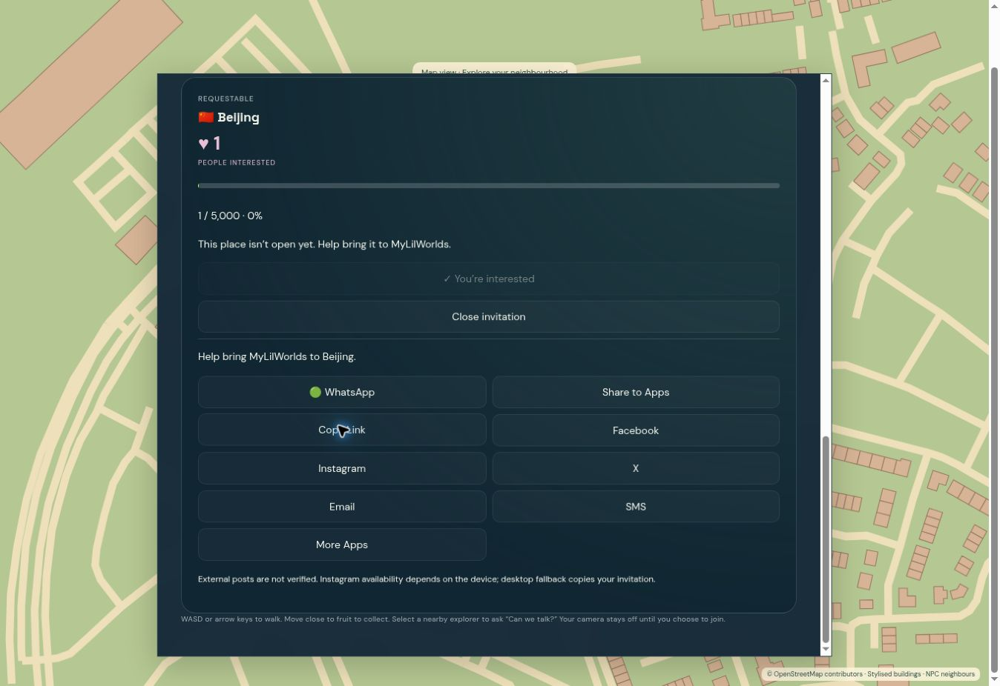

# Global expansion release validation — 2026-09-25

This report distinguishes automated verification from authenticated live and physical-device acceptance. An implemented feature is not automatically a live PASS. Current release readiness remains false until the outstanding acceptance gates are verified.

## Implemented release

- Existing 17 UK destinations preserved. Flat flag catalogue includes all 28 requested international names, including Shanghai, and 19 future request places. Uninstalled worlds cannot become active or accept world entry.
- Unique explicit demand, qualification, configurable thresholds, admin audit/alerts and opaque share/open/conversion records. Demand, five-share access and referral ledgers are separate.
- Safe physical/UI exits and reconnect recovery. Mapped parent malls, directory and non-overlapping virtual tenant doors. Sourced business cards, official website when available, coordinate directions, category interiors and disabled Coming Soon assistant.
- Exclusive parked rentals, versioned policy consent, agreed-price checks, one ledger debit, server acceleration/braking/collision, safe exit and expired-presence recovery. Boat/swim restricted to a configured mapped virtual zone. Buses retain authoritative schedules and real passenger membership, with faster approach/departure.
- Gifts/reactions on existing conversation/media/event/auditorium controls, server recipient/block/membership checks, idempotent immutable debit, no recipient Credit transfer.
- Existing business/admin portals extended with tenant-scoped profiles/analytics and configurable destinations, demand, vehicles, gifts. Advertising supports existing enquiries/campaign scheduling with upgraded boards.

## Test evidence before deployment

| Gate | Result | Evidence scope |
|---|---|---|
| Full backend suite | PASS | 145 tests before final bus-speed test; isolated test database |
| Affected transport/integration suite | PASS | 22 tests including bus speed, gift contexts, concurrency, exits, rentals, water and mall ownership |
| Frontend unit suite | PASS | 18 tests |
| Camera projection checks | PASS | 40 camera-relative projection cases |
| Next production build | PASS | Compiled, typechecked, pages generated |
| Migration chain | PASS | Fresh upgrade to fk25, metadata consistency, existing business funds constraint preserved |
| Full inventory bootstrap | PASS | Fresh database and repeat seed; no production test users inserted |

## Evidence limits

International catalogue entries are REQUESTABLE without installed approved maps. No roads, tenants, people or events were invented. Midsummer Place enrichment uses attributed OpenStreetMap relation data; virtual interiors are category templates, not surveyed replicas. Rental assets use platform-owned generic designs. Only one explicitly configured virtual water area is enabled.

No physical mobile/tablet, WebGL/GPU or real multi-user microphone/camera acceptance is represented by automated tests. The current service does not provide the Super Admin bootstrap configuration; no owner identity was fabricated or elevated. Authenticated consumer, merchant and owner live journeys require authorised sessions.

Deployment identity and the final live acceptance matrix will be appended after deployment verification.

## First deployment finding

Commit e30f967 passed all 146 backend tests in the Railway container (160.61 seconds) and its production frontend build. Deployment 4e0af56b-1acf-444d-96d7-85689332790c failed startup because the request pool's 10-second idle-in-transaction timeout closed PostgreSQL during CPU-bound map inventory preparation. The previous deployment remained available. Correction: a transaction-local 120-second startup-only idle allowance and bounded 200-row import batches. Normal request timeouts remain unchanged. The existing account signed in through secure authentication; no credentials were exposed.

## Authenticated live finding

Deployment 09bb46a1-4325-41cb-84ba-f7b1307ab27c (9dca744) became healthy; its 146 backend tests passed in 158.53 seconds. Live catalogue returned 64 entries, 17 active UK worlds, all 28 international names, and Shanghai REQUESTABLE. Existing four Starter Worlds and separate share progress survived. Beijing explicit interest became one; reload/request landing preserved the disabled repeat-vote state. Copy, WhatsApp, Facebook, X and Instagram desktop fallback prepared invitations without additional votes or automatic posts. Public request metadata exposed no account identity.

A real saved InteriorVisit from another city blocked entry before a scene was loaded. This is an acceptance failure discovered and fixed in the next revision: explicit entry to an already-authorised world first recovers the saved exterior and retires the stale visit. A regression test also ensures a locked destination cannot use this path to bypass access.

Live control hit-testing found the Rentals/Transit buttons underneath the harvest card in the canvas stacking context. The controls now render in a separate responsive overlay, hide while another panel is active, and preserve the existing action handlers. Final verification includes browser element hit-testing and opening the actual rental panel.

## Final deployed revision

- URL: https://pulseworld-production.up.railway.app/
- Application commit: ac64c0c42f2f0c498b5af9e264dca354091fd0d9.
- Railway deployment: c1b543c0-dab0-4c5e-be11-d778cde631b4 — SUCCESS.
- Latest backend revision independently passed **147 tests** in the Railway container, 172.28 seconds. The final client-only revision reused that backend and passed its production frontend build.
- Existing repository, service, domain, PostgreSQL and Redis retained. No new account, owner elevation, infrastructure or unrelated financial reset.

## Final live observations

1. Existing user authentication and retained session worked. Four Starter Worlds, the additional existing unlocked world, Cambridge's 2/5 share progress and wallet balance remained intact.
2. Catalogue returned 64 destinations and 17 active worlds. Flags, UK home section, flat search, separate Milton Keynes entries and Shanghai were visible. Inactive destinations had no invented maps or online activity.
3. Beijing interest changed from 0 to 1 after explicit action. Repeat-vote controls remained disabled on the shared landing. Sharing did not add interest or consume Starter World slots. Public invite API returned only destination/code and no private account data.
4. Copy link produced confirmation. WhatsApp, Facebook and X opened the appropriate app/composer handoff. Instagram on this desktop copied the prepared invitation with honest wording. No external post or mobile-native delivery is claimed. The unauthenticated shared URL served OpenGraph title/image metadata.
5. The real saved-interior entry defect was reproduced, fixed and retested: London loaded, its current-city label was correct, realtime connection became live, collectibles and the 120-PC wallet appeared, and London presence became one.
6. The Rentals/Transit/public-entry/advertising button hit areas were checked against the visible DOM after the overlay fix; all four were unobstructed. Rentals opened correctly. Virtual policy consent persisted across refresh. Far-away rental was rejected without a debit. Walking reduced pickup distance from 11m to 8m.
7. The signed-in non-owner was rejected from Super Admin. Business portal loaded its own workspace and showed the user's empty business state without another merchant's data. Unauthenticated Super Admin API returned 401.
8. Runtime logs showed completed startup and accepted realtime connections. Health returned ready, environment staging, release_ready false.

The browser connection stalled after the nearby bike-rental attempt. That attempt's active lease and UI exit are not claimed as verified; the configured lease expires automatically. A physical-device/multi-user session is still required for rendered vehicles/interiors/signage, camera/audio, group gifts, auditorium performance and responsive touch acceptance.

## Acceptance matrix

**PASS** means the stated evidence was actually observed. Automated PASS does not mean every live UI/device journey passed. **FAIL — unverified** means the requested acceptance gate remains incomplete, not that a specific defect was established. International entries are a catalogue/demand PASS; playable international world launch remains unavailable until approved map data is installed and an authorised owner activates it.

### GLOBAL EXPANSION

| Check | Automated | Live acceptance | Evidence / limit |
|---|---|---|---|
| UK home-market priority | PASS | PASS | Catalogue API tests plus frontend build; visual acceptance separate. International worlds without approved maps remain requestable. |
| Flag-based international UI | PASS | PASS | Catalogue API tests plus frontend build; visual acceptance separate. International worlds without approved maps remain requestable. |
| No country directory | PASS | PASS | Catalogue API tests plus frontend build; visual acceptance separate. International worlds without approved maps remain requestable. |
| International destinations | PASS | PASS | Catalogue API tests plus frontend build; visual acceptance separate. International worlds without approved maps remain requestable. |
| Shanghai included | PASS | PASS | Catalogue API tests plus frontend build; visual acceptance separate. International worlds without approved maps remain requestable. |
| Search | PASS | PASS | Catalogue API tests plus frontend build; visual acceptance separate. International worlds without approved maps remain requestable. |
| Status system | PASS | FAIL — unverified | Lifecycle, hidden/disabled visibility, unavailable-map activation guard. |

### CITY DEMAND

| Check | Automated | Live acceptance | Evidence / limit |
|---|---|---|---|
| Request place | PASS | PASS | Explicit interest uniqueness, goal transition, audit/RBAC, separate invite conversion and activation guard tested. |
| Unique interest | PASS | PASS — repeat UI disabled and persistence verified | Explicit interest uniqueness, goal transition, audit/RBAC, separate invite conversion and activation guard tested. Concurrent duplicate server submissions were tested in the isolated suite. |
| Real demand counter | PASS | PASS | Explicit interest uniqueness, goal transition, audit/RBAC, separate invite conversion and activation guard tested. |
| Threshold | PASS | FAIL — unverified | Explicit interest uniqueness, goal transition, audit/RBAC, separate invite conversion and activation guard tested. |
| Admin threshold override | PASS | FAIL — unverified | Explicit interest uniqueness, goal transition, audit/RBAC, separate invite conversion and activation guard tested. |
| Share conversion | PASS | FAIL — unverified | Explicit interest uniqueness, goal transition, audit/RBAC, separate invite conversion and activation guard tested. |
| Qualified state | PASS | FAIL — unverified | Explicit interest uniqueness, goal transition, audit/RBAC, separate invite conversion and activation guard tested. |
| Admin activation | PASS | FAIL — unverified | Explicit interest uniqueness, goal transition, audit/RBAC, separate invite conversion and activation guard tested. |
| Social sharing | PASS | PASS — copy/composer/desktop fallback | Opaque links, idempotent channel events and separation from votes/access tested; external publishing is not verifiable. Live Copy, WhatsApp/Facebook/X handoffs and Instagram desktop copy tested; no post claimed. Native mobile/email/SMS handlers unverified. |

### VEHICLES

| Check | Automated | Live acceptance | Evidence / limit |
|---|---|---|---|
| Car rental | PASS | FAIL — unverified | Exclusive asset, policy, quote, repeated UUID/debit, server acceleration, speed bounds, recovery and safe return tests. |
| Bike rental | PASS | FAIL — unverified | Exclusive asset, policy, quote, repeated UUID/debit, server acceleration, speed bounds, recovery and safe return tests. |
| Credit debit | PASS | FAIL — unverified | Exclusive asset, policy, quote, repeated UUID/debit, server acceleration, speed bounds, recovery and safe return tests. |
| Acceleration | PASS | FAIL — unverified | Exclusive asset, policy, quote, repeated UUID/debit, server acceleration, speed bounds, recovery and safe return tests. |
| Vehicle speed hierarchy | PASS | FAIL — unverified | Exclusive asset, policy, quote, repeated UUID/debit, server acceleration, speed bounds, recovery and safe return tests. |
| Safe vehicle exit | PASS | FAIL — unverified | Exclusive asset, policy, quote, repeated UUID/debit, server acceleration, speed bounds, recovery and safe return tests. |

### BUILDINGS

| Check | Automated | Live acceptance | Evidence / limit |
|---|---|---|---|
| Public building entry | PASS | FAIL — unverified | API entry/exit and timeout/closure recovery, real mapped mall import, distinct tenant coordinates and parent-store return tested. UI rendering requires browser verification. |
| Mall hierarchy | PASS | FAIL — unverified | API entry/exit and timeout/closure recovery, real mapped mall import, distinct tenant coordinates and parent-store return tested. UI rendering requires browser verification. |
| Mall directory | PASS | FAIL — unverified | API entry/exit and timeout/closure recovery, real mapped mall import, distinct tenant coordinates and parent-store return tested. UI rendering requires browser verification. |
| Tenant placement | PASS | FAIL — unverified | API entry/exit and timeout/closure recovery, real mapped mall import, distinct tenant coordinates and parent-store return tested. UI rendering requires browser verification. |
| Store entry | PASS | FAIL — unverified | API entry/exit and timeout/closure recovery, real mapped mall import, distinct tenant coordinates and parent-store return tested. UI rendering requires browser verification. |
| Physical exit | PASS | FAIL — unverified | API entry/exit and timeout/closure recovery, real mapped mall import, distinct tenant coordinates and parent-store return tested. UI rendering requires browser verification. |
| UI exit | PASS | FAIL — unverified | API entry/exit and timeout/closure recovery, real mapped mall import, distinct tenant coordinates and parent-store return tested. UI rendering requires browser verification. |
| No trapped users | PASS | PASS — observed stale-visit defect fixed/retested | API entry/exit and timeout/closure recovery, real mapped mall import, distinct tenant coordinates and parent-store return tested. UI rendering requires browser verification. Recovered the real account from saved cross-city interior and entered London without payment. |

### BUSINESS

| Check | Automated | Live acceptance | Evidence / limit |
|---|---|---|---|
| Professional signage | FAIL — unverified | FAIL — unverified | Build completed; rendered WebGL signage and distance readability require GPU visual acceptance. |
| Business card | PASS | FAIL — unverified | Sourced card/profile fields, safe URL validation, assistant disabled, idempotent stable identities and merchant access tested. Browser workflows separate. |
| Visit Website | PASS | FAIL — unverified | Sourced card/profile fields, safe URL validation, assistant disabled, idempotent stable identities and merchant access tested. Browser workflows separate. |
| Store Assistant Coming Soon | PASS | FAIL — unverified | Sourced card/profile fields, safe URL validation, assistant disabled, idempotent stable identities and merchant access tested. Browser workflows separate. |
| AI Assistant remains disabled | PASS | FAIL — unverified | Sourced card/profile fields, safe URL validation, assistant disabled, idempotent stable identities and merchant access tested. Browser workflows separate. |
| Claim-ready data | PASS | FAIL — unverified | Sourced card/profile fields, safe URL validation, assistant disabled, idempotent stable identities and merchant access tested. Browser workflows separate. |
| Business Portal | PASS | FAIL — unverified | Sourced card/profile fields, safe URL validation, assistant disabled, idempotent stable identities and merchant access tested. Browser workflows separate. |
| Category-specific interiors | FAIL — unverified | FAIL — unverified | Category selection covered by import tests; café/fashion/grocery rendered experience requires GPU inspection. |

### GIFTS

| Check | Automated | Live acceptance | Evidence / limit |
|---|---|---|---|
| 1-to-1 Chat | PASS | FAIL — unverified | Existing conversation-family and live-event eligibility, all media contexts, correct recipients, blocks, UUID retry, immutable price/debit and reaction limits tested. No real multi-user media session claimed. |
| Group Chat | PASS | FAIL — unverified | Existing conversation-family and live-event eligibility, all media contexts, correct recipients, blocks, UUID retry, immutable price/debit and reaction limits tested. No real multi-user media session claimed. |
| Voice | PASS | FAIL — unverified | Existing conversation-family and live-event eligibility, all media contexts, correct recipients, blocks, UUID retry, immutable price/debit and reaction limits tested. No real multi-user media session claimed. |
| LiveFace | PASS | FAIL — unverified | Existing conversation-family and live-event eligibility, all media contexts, correct recipients, blocks, UUID retry, immutable price/debit and reaction limits tested. No real multi-user media session claimed. |
| Event | PASS | FAIL — unverified | Existing conversation-family and live-event eligibility, all media contexts, correct recipients, blocks, UUID retry, immutable price/debit and reaction limits tested. No real multi-user media session claimed. |
| Auditorium | PASS | FAIL — unverified | Existing conversation-family and live-event eligibility, all media contexts, correct recipients, blocks, UUID retry, immutable price/debit and reaction limits tested. No real multi-user media session claimed. |
| Free reactions | PASS | FAIL — unverified | Existing conversation-family and live-event eligibility, all media contexts, correct recipients, blocks, UUID retry, immutable price/debit and reaction limits tested. No real multi-user media session claimed. |
| Wallet integrity | PASS | FAIL — unverified | Existing conversation-family and live-event eligibility, all media contexts, correct recipients, blocks, UUID retry, immutable price/debit and reaction limits tested. No real multi-user media session claimed. |

### ADVERTISING

| Check | Automated | Live acceptance | Evidence / limit |
|---|---|---|---|
| Premium boards | FAIL — unverified | FAIL — unverified | Upgraded meshes/copy build successfully; WebGL visual QA outstanding. |
| Marketing copy | FAIL — unverified | FAIL — unverified | Upgraded meshes/copy build successfully; WebGL visual QA outstanding. |
| Advertise CTA | PASS | FAIL — unverified | Existing API enquiry, owner restriction, campaign assignment and scheduled visibility regression tests passed; authenticated end-to-end owner flow outstanding. |
| Enquiry persistence | PASS | FAIL — unverified | Existing API enquiry, owner restriction, campaign assignment and scheduled visibility regression tests passed; authenticated end-to-end owner flow outstanding. |
| Super Admin campaign | PASS | FAIL — unverified | Existing API enquiry, owner restriction, campaign assignment and scheduled visibility regression tests passed; authenticated end-to-end owner flow outstanding. |
| Scheduling | PASS | FAIL — unverified | Existing API enquiry, owner restriction, campaign assignment and scheduled visibility regression tests passed; authenticated end-to-end owner flow outstanding. |
| Board assignment | PASS | FAIL — unverified | Existing API enquiry, owner restriction, campaign assignment and scheduled visibility regression tests passed; authenticated end-to-end owner flow outstanding. |

### AUDITORIUM

| Check | Automated | Live acceptance | Evidence / limit |
|---|---|---|---|
| Existing event flow preserved | PASS | FAIL — unverified | Existing event/venue, stage permissions, audience and gift/reaction API tests passed; real media performance not tested. |
| Live Auditorium | PASS | FAIL — unverified | Existing event/venue, stage permissions, audience and gift/reaction API tests passed; real media performance not tested. |
| Stage | PASS | FAIL — unverified | Existing event/venue, stage permissions, audience and gift/reaction API tests passed; real media performance not tested. |
| Audience | PASS | FAIL — unverified | Existing event/venue, stage permissions, audience and gift/reaction API tests passed; real media performance not tested. |
| Reactions | PASS | FAIL — unverified | Existing event/venue, stage permissions, audience and gift/reaction API tests passed; real media performance not tested. |
| Gifts | PASS | FAIL — unverified | Existing event/venue, stage permissions, audience and gift/reaction API tests passed; real media performance not tested. |
| Raise Hand | PASS | FAIL — unverified | Existing event/venue, stage permissions, audience and gift/reaction API tests passed; real media performance not tested. |
| Join Stage | PASS | FAIL — unverified | Existing event/venue, stage permissions, audience and gift/reaction API tests passed; real media performance not tested. |
| Existing Expand UI | FAIL — unverified | FAIL — unverified | Media layouts retained; full real-camera/browser acceptance remains outstanding. |
| Existing Minimise UI | FAIL — unverified | FAIL — unverified | Media layouts retained; full real-camera/browser acceptance remains outstanding. |
| Existing Full Screen | FAIL — unverified | FAIL — unverified | Media layouts retained; full real-camera/browser acceptance remains outstanding. |

### PORTALS

| Check | Automated | Live acceptance | Evidence / limit |
|---|---|---|---|
| Consumer App separation | PASS | PASS | Existing route boundaries and server owner/manager/super-admin access tests; no replacement backend/authentication. |
| Business Portal separation | PASS | PASS | Existing route boundaries and server owner/manager/super-admin access tests; no replacement backend/authentication. |
| Super Admin separation | PASS | PASS | Existing route boundaries and server owner/manager/super-admin access tests; no replacement backend/authentication. |
| Shared modular backend | PASS | FAIL — unverified | Existing route boundaries and server owner/manager/super-admin access tests; no replacement backend/authentication. |
| RBAC | PASS | PASS — unauthorised Super Admin rejected | Existing route boundaries and server owner/manager/super-admin access tests; no replacement backend/authentication. No privileged owner identity available to verify positive admin workflows. |

### FRIENDS / WATER

| Check | Automated | Live acceptance | Evidence / limit |
|---|---|---|---|
| Mutual friendship and remote consented calls | PASS | FAIL — unverified | Friend request/accept/remove/block and cross-world media consent API tests. |
| Boat rental and swimming boundaries | PASS | FAIL — unverified | Configured mapped zone, holes/land rejection, exclusive boat, multiple swimmers, safe shore exit and no extra charge tests. |
| Safe return to shore | PASS | FAIL — unverified | Configured mapped zone, holes/land rejection, exclusive boat, multiple swimmers, safe shore exit and no extra charge tests. |
| Boat/swim visual animation | FAIL — unverified | FAIL — unverified | Movement/pose implementation builds; GPU/mobile rendering unverified. |

### REGRESSION

| Check | Automated | Live acceptance | Evidence / limit |
|---|---|---|---|
| Authentication | PASS | PASS — tested journey | Full 146-test backend suite and applicable frontend tests. This is automated coverage, not complete live acceptance for every user journey. Existing account sign-in, London entry/realtime presence, correct dropdown and walking toward pickup. |
| Registration | PASS | FAIL — unverified | Full 146-test backend suite and applicable frontend tests. This is automated coverage, not complete live acceptance for every user journey. |
| Profiles | PASS | FAIL — unverified | Full 146-test backend suite and applicable frontend tests. This is automated coverage, not complete live acceptance for every user journey. |
| Existing UK worlds | PASS | FAIL — unverified | Full 146-test backend suite and applicable frontend tests. This is automated coverage, not complete live acceptance for every user journey. |
| Four Starter Worlds | PASS | PASS — existing choices preserved | Full 146-test backend suite and applicable frontend tests. This is automated coverage, not complete live acceptance for every user journey. Existing four selections and prior share progress persisted; new-account selection flow covered in automated tests. |
| Share-to-Unlock | PASS | FAIL — unverified | Full 146-test backend suite and applicable frontend tests. This is automated coverage, not complete live acceptance for every user journey. |
| Presence | PASS | PASS — tested journey | Full 146-test backend suite and applicable frontend tests. This is automated coverage, not complete live acceptance for every user journey. Existing account sign-in, London entry/realtime presence, correct dropdown and walking toward pickup. |
| Online counts | PASS | PASS — tested journey | Full 146-test backend suite and applicable frontend tests. This is automated coverage, not complete live acceptance for every user journey. Existing account sign-in, London entry/realtime presence, correct dropdown and walking toward pickup. |
| Movement | PASS | PASS — tested journey | Full 146-test backend suite and applicable frontend tests. This is automated coverage, not complete live acceptance for every user journey. Existing account sign-in, London entry/realtime presence, correct dropdown and walking toward pickup. |
| Friends | PASS | FAIL — unverified | Full 146-test backend suite and applicable frontend tests. This is automated coverage, not complete live acceptance for every user journey. |
| Chat | PASS | FAIL — unverified | Full 146-test backend suite and applicable frontend tests. This is automated coverage, not complete live acceptance for every user journey. |
| Voice | PASS | FAIL — unverified | Full 146-test backend suite and applicable frontend tests. This is automated coverage, not complete live acceptance for every user journey. |
| LiveFace | PASS | FAIL — unverified | Full 146-test backend suite and applicable frontend tests. This is automated coverage, not complete live acceptance for every user journey. |
| Multi-person | PASS | FAIL — unverified | Full 146-test backend suite and applicable frontend tests. This is automated coverage, not complete live acceptance for every user journey. |
| Events | PASS | FAIL — unverified | Full 146-test backend suite and applicable frontend tests. This is automated coverage, not complete live acceptance for every user journey. |
| Live Auditorium | PASS | FAIL — unverified | Full 146-test backend suite and applicable frontend tests. This is automated coverage, not complete live acceptance for every user journey. |
| Transport | PASS | FAIL — unverified | Full 146-test backend suite and applicable frontend tests. This is automated coverage, not complete live acceptance for every user journey. |
| Vehicles | PASS | FAIL — unverified | Full 146-test backend suite and applicable frontend tests. This is automated coverage, not complete live acceptance for every user journey. |
| Wallet | PASS | FAIL — unverified | Full 146-test backend suite and applicable frontend tests. This is automated coverage, not complete live acceptance for every user journey. |
| Credits | PASS | FAIL — unverified | Full 146-test backend suite and applicable frontend tests. This is automated coverage, not complete live acceptance for every user journey. |
| Gifts | PASS | FAIL — unverified | Full 146-test backend suite and applicable frontend tests. This is automated coverage, not complete live acceptance for every user journey. |
| Fruit/Gems | PASS | FAIL — unverified | Full 146-test backend suite and applicable frontend tests. This is automated coverage, not complete live acceptance for every user journey. |
| Missions | PASS | FAIL — unverified | Full 146-test backend suite and applicable frontend tests. This is automated coverage, not complete live acceptance for every user journey. |
| Businesses | PASS | FAIL — unverified | Full 146-test backend suite and applicable frontend tests. This is automated coverage, not complete live acceptance for every user journey. |
| Buildings | PASS | FAIL — unverified | Full 146-test backend suite and applicable frontend tests. This is automated coverage, not complete live acceptance for every user journey. |
| Visit & Earn | PASS | FAIL — unverified | Full 146-test backend suite and applicable frontend tests. This is automated coverage, not complete live acceptance for every user journey. |
| Rankings | PASS | FAIL — unverified | Full 146-test backend suite and applicable frontend tests. This is automated coverage, not complete live acceptance for every user journey. |
| Advertising | PASS | FAIL — unverified | Full 146-test backend suite and applicable frontend tests. This is automated coverage, not complete live acceptance for every user journey. |
| Business Portal | PASS | FAIL — unverified | Full 146-test backend suite and applicable frontend tests. This is automated coverage, not complete live acceptance for every user journey. |
| Super Admin | PASS | FAIL — unverified | Full 146-test backend suite and applicable frontend tests. This is automated coverage, not complete live acceptance for every user journey. |
| Avatar | PASS | FAIL — unverified | Frontend build and 40 camera projection checks; visual/device behavior unverified. |
| 360 Camera | PASS | FAIL — unverified | Frontend build and 40 camera projection checks; visual/device behavior unverified. |
| City dropdown | PASS | PASS — tested journey | Frontend build; current-world checkmark/other-world Explore Now labels implemented. Existing account sign-in, London entry/realtime presence, correct dropdown and walking toward pickup. |
| Mobile | FAIL — unverified | FAIL — unverified | No physical touch/GPU/multi-device session certified. Desktop browser checks will be recorded individually. |
| Tablet | FAIL — unverified | FAIL — unverified | No physical touch/GPU/multi-device session certified. Desktop browser checks will be recorded individually. |
| Desktop | FAIL — unverified | PASS — tested DOM/fallback flows | No physical touch/GPU/multi-device session certified. Desktop browser checks will be recorded individually. Desktop catalogue, search, request, share, portal gates and controls; WebGL visuals unverified. |

## Remaining release gates

- Approved datasets are absent for the international playable worlds; those destinations correctly remain requestable.
- A legitimate Super Admin bootstrap/owner session is absent. Configure the documented existing bootstrap securely; do not elevate a consumer identity or embed credentials. Positive owner campaign/threshold/vehicle/gift workflows need owner acceptance.
- No claimed merchant account was provided for positive merchant-management live acceptance. Tenant isolation is covered by automated tests.
- Real multi-user LiveKit media, physical mobile/tablet touch, GPU rendering and native sharing require their corresponding devices/accounts.
- The service remains APP_ENV=staging with release_ready=false. Existing deployment/provider/policy gates are not overridden by test results.

### Visual evidence

